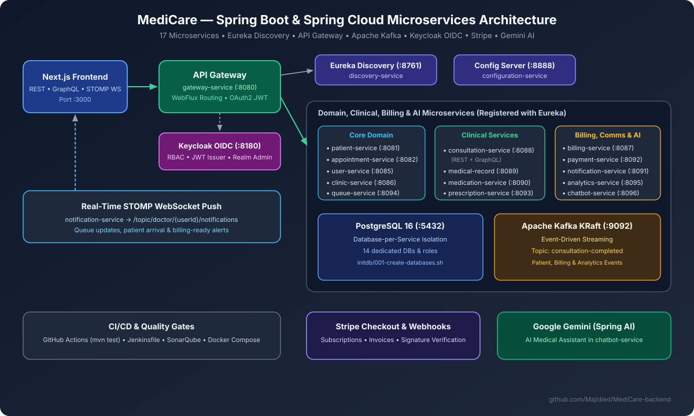
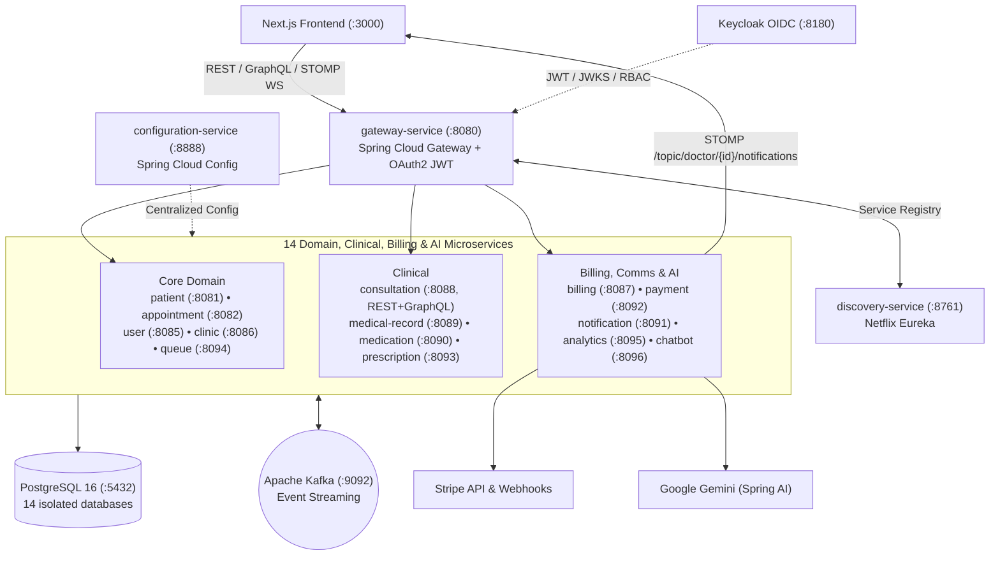
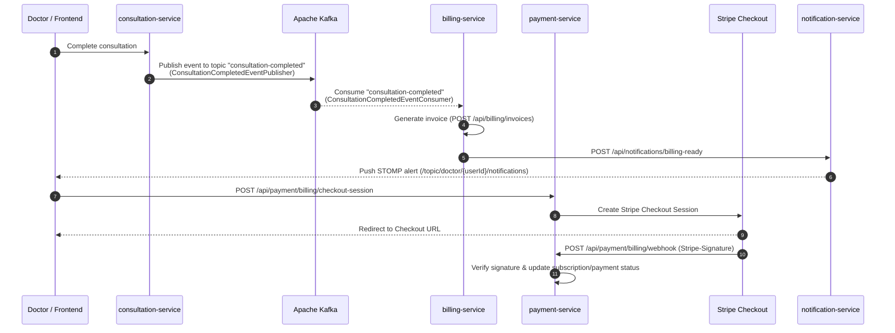
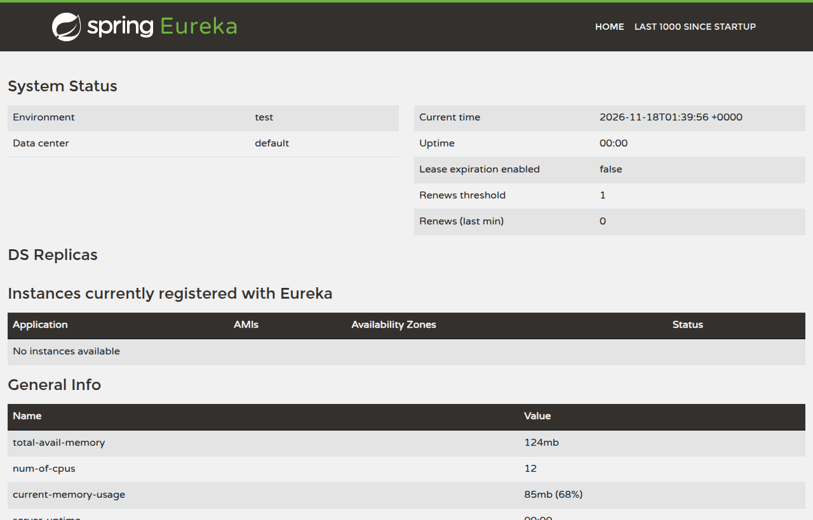

# MediCare — Microservices Backend (Spring Boot & Spring Cloud)

[](https://github.com/Majidied/MediCare-backend/actions/workflows/ci.yml)


Event-driven microservices backend for **MediCare** (originally developed as *CabinetX*), a multi-clinic medical management platform built with **Java 21**, **Spring Boot**, **Spring Cloud** (Eureka Discovery, Gateway WebFlux, Config Server), **PostgreSQL** (database-per-service), **Apache Kafka**, **Keycloak OIDC**, **GraphQL**, **Stripe**, **STOMP WebSockets**, and **Spring AI (Google Gemini)**.

---

## Project Status

**Active / Feature-Complete MVP** — All 17 microservices, Docker Compose orchestration (with integrated Kafka & PostgreSQL), Jenkins + SonarQube pipeline, and GitHub Actions CI are configured.

---

## System Architecture





---

## Event-Driven Workflow: Consultation → Billing → Payment → Notification



---

## Microservices & Port Map

| Service | Host Port | Gateway Route | Responsibility |
| :--- | :---: | :--- | :--- |
| `discovery-service` | `8761` | — | Netflix Eureka service registry & dashboard |
| `configuration-service` | `8888` | — | Spring Cloud Config Server |
| `gateway-service` | `8080` | `/*` | Reactive API Gateway + Keycloak JWT validation |
| `patient-service` | `8081` | `/api/patients/**` | Patient profiles & Kafka patient events |
| `appointment-service` | `8082` | `/api/appointments/**`, `/api/queue/**` | Scheduling, slots & waiting room queue |
| `user-service` | `8085` | `/api/users/**` | Doctor/secretary accounts & Keycloak Admin sync |
| `clinic-service` | `8086` | `/api/clinics/**` | Multi-clinic configuration & subscription plans |
| `billing-service` | `8087` | `/api/billing/**` | Automated invoicing & PDF generation |
| `consultation-service` | `8088` | `/api/consultations/**` | Clinical consultations (REST + GraphQL) |
| `medical-record-service` | `8089` | `/api/records/**` | Electronic health records (EHR) |
| `medication-service` | `8090` | `/api/medications/**` | Medication catalog & dosage reference |
| `notification-service` | `8091` | `/api/notifications/**` | Real-time STOMP WebSocket notifications |
| `payment-service` | `8092` | `/payments/**`, `/api/payment/billing/**` | Stripe Checkout & webhook verification |
| `prescription-service` | `8093` | `/api/prescriptions/**` | Digital prescriptions & signature support |
| `queue-service` | `8094` | — | Dedicated waiting queue service module |
| `analytics-service` | `8095` | `/api/statistics/**` | Clinic & global KPIs |
| `chatbot-service` | `8096` | `/chatbot/**` | Spring AI (Google Gemini) assistant |
| `postgres` | `5432` | — | PostgreSQL 16 (14 isolated DBs via `initdb`) |
| `broker` (Kafka) | `9092` | — | Apache Kafka KRaft event broker |

---

## Screenshots

### Eureka Service Discovery Dashboard (`:8761`)


> **Note:** OpenAPI/Swagger UI (`springdoc-openapi-ui`) is included in every domain microservice (`http://localhost:<service-port>/swagger-ui.html`) when the full database and config stack are running.

---

## Quick Start (Docker Compose)

1. **Clone the repository:**
   ```bash
   git clone https://github.com/Majidied/MediCare-backend.git
   cd MediCare-backend
   ```

2. **Configure environment variables:**
   ```bash
   cp .env.example .env
   ```
   Fill in your PostgreSQL passwords, Keycloak OIDC issuer/client secret, Stripe keys, and Gemini API key. Place service-specific overrides in `./env/<service-name>.env` if needed.

3. **Start the stack (PostgreSQL, Kafka, Config Server, Eureka, Gateway & Microservices):**
   ```bash
   docker compose up -d --build
   ```

4. **Verify infrastructure:**
   - **Eureka Dashboard:** `http://localhost:8761`
   - **API Gateway:** `http://localhost:8080`
   - **PostgreSQL:** `localhost:5432`
   - **Kafka Broker:** `localhost:9092`

For local JVM execution without containers, use [start-services.sh](start-services.sh) (Linux/macOS) or [start-services.ps1](start-services.ps1) (Windows) with memory profiles tuned in [.env.memory](.env.memory).

---

## Testing & CI/CD

Run unit tests inside any microservice module:

```bash
cd appointment-service
mvn -B test
```

- **GitHub Actions:** [.github/workflows/ci.yml](.github/workflows/ci.yml) builds and tests services on push/PR to `main`.
- **Jenkins + SonarQube:** [Jenkinsfile](Jenkinsfile) orchestrates sequential low-memory builds (`-Xmx384m`) and per-service SonarQube scans.

---

## License

This project is licensed under the MIT License — see [LICENSE](LICENSE) for details.
